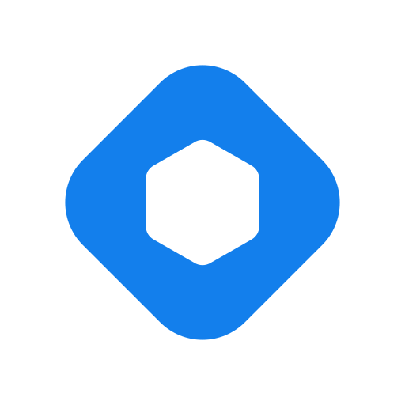
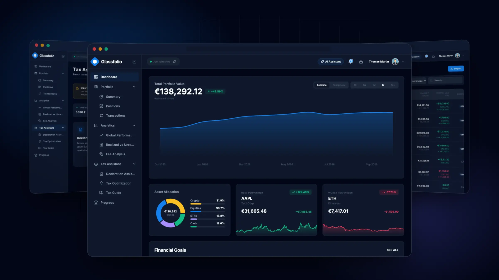
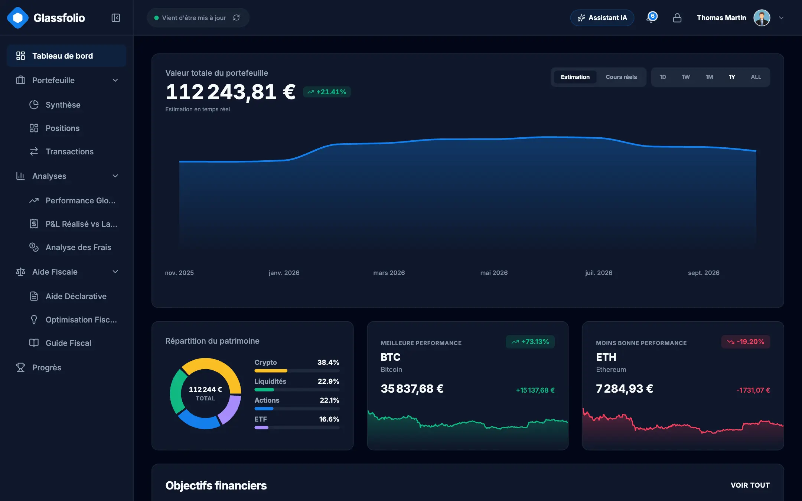
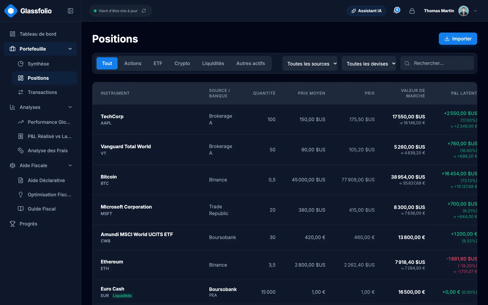
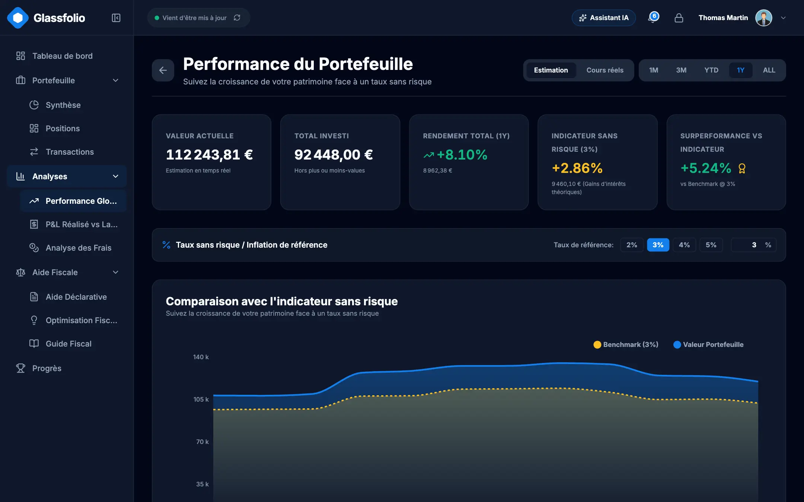
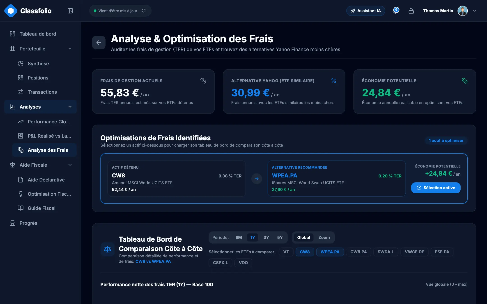
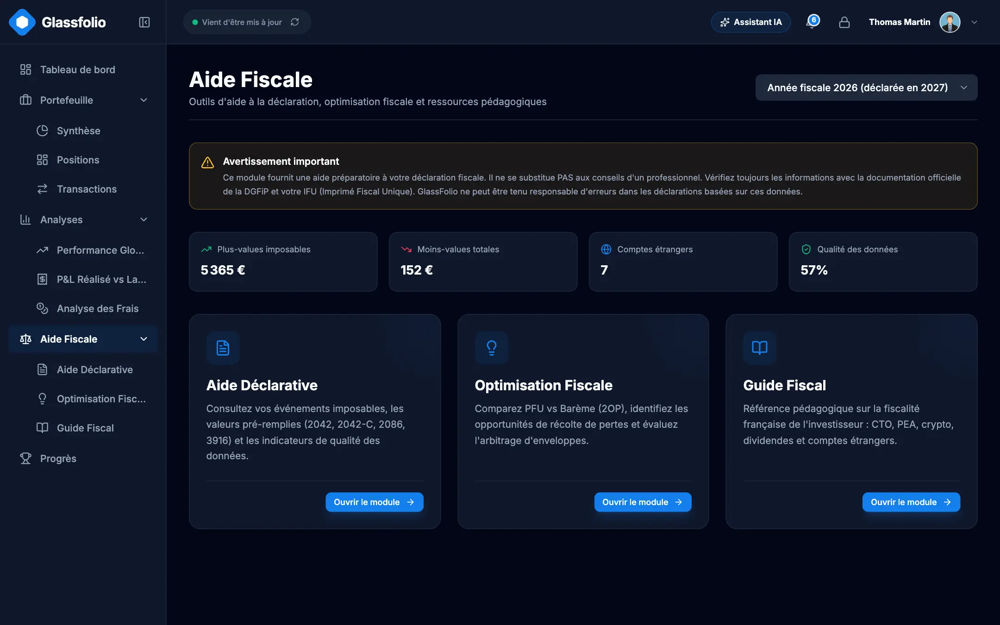
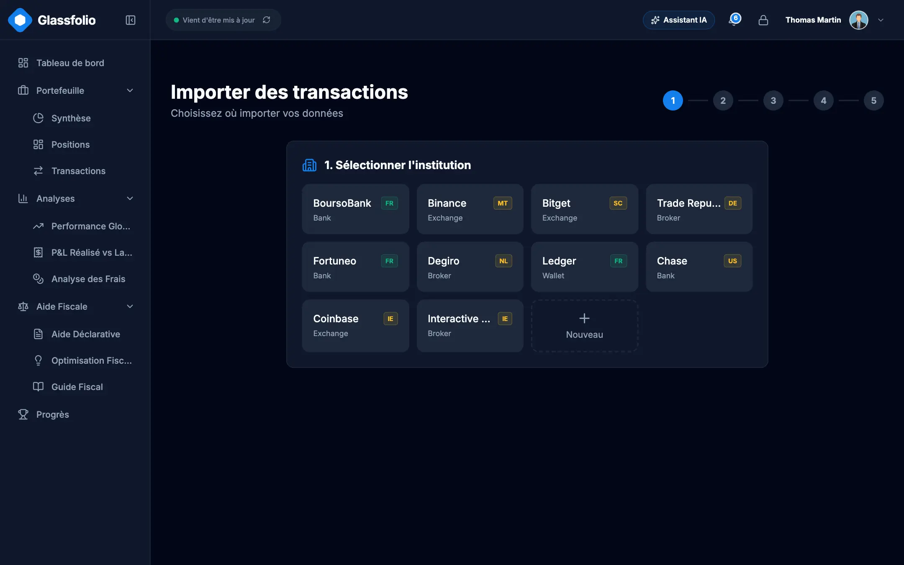
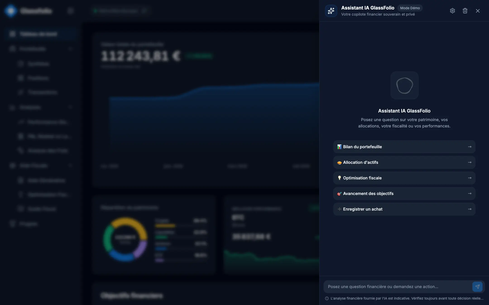
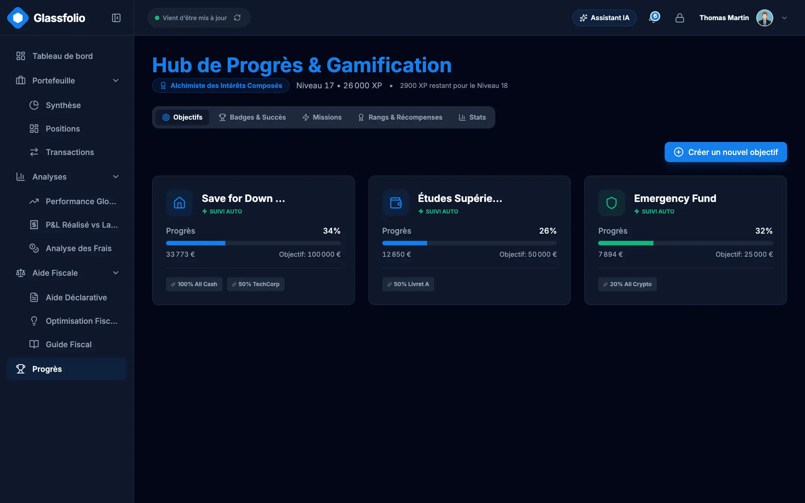

<div align="center">



# GlassFolio

**Votre patrimoine, chiffré de votre côté. Auto-hébergé ou dans le cloud.**

Un tableau de bord patrimonial qui garde vos données chiffrées, prépare votre déclaration avec un moteur fiscal modulaire (règles françaises intégrées) et tourne sur votre machine ou dans le cloud géré.

[](https://github.com/Damien-Esilv/GlassFolio/actions/workflows/ci.yml)
[](LICENSE)
[](package.json)
[](#-auto-hébergement-avec-docker)
[](locales)

[English](README.md) · **Français**

[**Site**](https://glassfolio.dev) · [**Auto-héberger**](#-auto-hébergement-avec-docker) · [**Feuille de route**](https://glassfolio.dev/roadmap) · [**Nouveautés**](https://glassfolio.dev/changelog)

<br />



</div>

---

## Pourquoi GlassFolio

1. **Chiffré avant de quitter votre navigateur.** Transactions, positions, objectifs et secrets vivent dans un coffre côté client : AES-256-GCM, avec des clés dérivées de votre mot de passe maître par PBKDF2 (600 000 itérations) et HKDF. Un serveur ne voit jamais que du texte chiffré.
2. **Auto-hébergé ou cloud, à vous de choisir.** Une commande démarre un conteneur Docker durci sur votre machine ou votre NAS, sans compte ni télémétrie. Ou utilisez la version cloud gérée : rien à installer, synchronisée sur vos appareils. Même application, même chiffrement.
3. **Un moteur fiscal modulaire.** Les règles françaises sont intégrées nativement : comparez le PFU et le barème progressif sur vos chiffres réels et préparez les Cerfa 2042, 2074 et 3916. Les règles sont isolées par juridiction pour accueillir de nouveaux pays.
4. **Un assistant IA qui demande d'abord.** Interrogez votre portefeuille en langage naturel, avec un modèle local (Ollama) ou votre propre clé d'API. 35 outils sont exposés à l'assistant intégré et aux clients MCP externes, et toute action qui modifie des données financières exige votre approbation explicite.
5. **Importez votre historique.** Importez les exports CSV de vos courtiers et banques avec mappage des colonnes, aperçu en direct, protection contre les doublons et annulation en un clic.

## ✨ Fonctionnalités

### Portefeuille et marchés
- Suivi multi-actifs : actions, ETF, crypto, liquidités et épargne, regroupés par classe d'actifs, établissement et compte (PEA, CTO, assurance-vie, wallets…).
- Positions avec quantité, prix de revient moyen, valorisation et plus-values latentes, ainsi que P&L réalisé et non réalisé.
- Cours de marché via Yahoo Finance et CoinGecko, conversion multi-devises, repli hors ligne propre.
- Registre complet des transactions (achats, ventes, dividendes, frais, dépôts, retraits) avec filtres et recherche.

### Analyses
- Performance dans le temps, comparaison à des indices et courbes rebasées (base 100), jusqu'à 8 séries dont les couleurs ne se confondent jamais avec celles des gains et pertes.
- Analyse des frais d'ETF : coûts récurrents et effet cumulé sur plusieurs décennies, plus comparaison d'ETF côte à côte.
- Objectifs financiers avec suivi de progression, et système de progression d'investisseur (rangs, quêtes, séries).

### Moteur fiscal
- Moteur modulaire : les règles sont isolées par juridiction. Les règles françaises sont intégrées aujourd'hui ; de nouvelles juridictions s'ajoutent au même pipeline.
- Comparaison PFU et barème progressif, avec les règles du PEA et des durées de détention.
- Assistant de déclaration pour les Cerfa **2042**, **2074** et **3916**, et pistes d'optimisation fiscale.
- Prix de revient calculé sur un registre commun, avec une méthode au choix.

> GlassFolio fournit des estimations et un accompagnement pédagogique. Ce n'est pas un conseil fiscal ou en investissement certifié.

### Import et sauvegarde
- Préréglages qui détectent automatiquement les exports Binance, Bitget, BoursoBank, Trade Republic, Coinbase, Kraken et GlassFolio, et une étape de mappage par colonne pour tout le reste.
- Mode historique et mode instantané (snapshot), import de liquidités dédié, détection des doublons et annulation par lot.
- Sauvegarde JSON complète, et assistant de fusion qui prévisualise les changements avant de toucher à vos données.

### IA et MCP
- Assistant intégré avec streaming, blocs de raisonnement visibles et cartes d'approbation pour les actions sensibles.
- Modèles locaux via Ollama (aucune donnée ne quitte votre machine), ou OpenAI, Anthropic, OpenRouter et Groq avec des clés stockées dans votre coffre chiffré.
- Des garde-fous masquent les secrets (clés, codes de récupération, graines TOTP) avant que quoi que ce soit n'atteigne un modèle.
- Un [pont MCP](mcp-server/index.mjs) : Claude Code, Codex, Cursor, Antigravity et les autres clients MCP appellent les outils de l'application sur vos propres données, via votre onglet ouvert et déverrouillé, et chaque modification attend votre accord. Un serveur local (Docker ou `npm run dev`) l'inclut sur `/mcp` ; pour GlassFolio en ligne, lancez-le sur votre ordinateur avec `npm run mcp -- serve`. Voir la [documentation](https://glassfolio.dev/fr/docs).

### Sécurité et confidentialité
- Mots de passe évalués selon les recommandations NIST SP 800-63B, double authentification TOTP avec codes de secours, passkeys WebAuthn et clé de récupération d'urgence.
- Coffre de secrets chiffré et journal d'audit de sécurité chiffré en ajout seul.
- Content-Security-Policy stricte (`script-src 'self'`, Trusted Types), aucun script tiers.

### Expérience
- Trois thèmes (clair, sombre, nuit), anglais et français, 16 espaces de noms de traduction.
- Des jetons de couleur sémantiques partout : modifier un jeton se répercute sur tous les écrans et graphiques.

## 📸 Captures d'écran

<table>
  <tr>
    <td width="50%"><br /><sub><b>Tableau de bord</b> : patrimoine, répartition, performances</sub></td>
    <td width="50%"><br /><sub><b>Positions</b> : lignes par compte et classe d'actifs</sub></td>
  </tr>
  <tr>
    <td width="50%"><br /><sub><b>Performance</b> : comparaison à un indice dans le temps</sub></td>
    <td width="50%"><br /><sub><b>Frais</b> : coût annuel et cumulé de chaque fonds</sub></td>
  </tr>
  <tr>
    <td width="50%"><br /><sub><b>Moteur fiscal</b> : PFU ou barème, assistant Cerfa</sub></td>
    <td width="50%"><br /><sub><b>Import</b> : formats de courtiers, mappage des colonnes, aperçu en direct</sub></td>
  </tr>
  <tr>
    <td width="50%"><br /><sub><b>Assistant IA</b> : réponses tirées de vos données</sub></td>
    <td width="50%"><br /><sub><b>Progression</b> : objectifs d'épargne, rangs et quêtes</sub></td>
  </tr>
</table>

## 🐳 Auto-hébergement avec Docker

L'image sert l'application, relaie les données de marché sur la même origine et stocke les enregistrements de votre coffre sur un volume Docker. Il faut [Docker](https://docs.docker.com/get-docker/) avec Compose, et Node 22 sur l'hôte uniquement pour les commandes `npm run docker:*`.

### Démarrage rapide

```bash
git clone https://github.com/Damien-Esilv/GlassFolio.git && cd GlassFolio && npm run docker:up
```

Ouvrez <http://localhost:3000>, créez votre mot de passe maître, et c'est prêt.

Pour explorer le compte de démonstration à la place, démarrez avec `GLASSFOLIO_DEMO=1 npm run docker:up` : l'application s'ouvre directement sur la démo (`npm run docker:up` seul ne la propose jamais).

```bash
npm run docker:logs    # suivre les journaux
npm run docker:down    # arrêter le conteneur (vos données sont conservées)
npm run docker:smoke   # construire un conteneur jetable et le vérifier de bout en bout
```

### Configuration

Définissez ces variables dans `docker/docker.env` (valeurs par défaut non secrètes) ou dans votre shell. Les secrets, comme le jeton d'accès, vont dans votre shell, jamais dans un fichier.

| Variable | Défaut | Rôle |
|---|---|---|
| `GLASSFOLIO_PORT` | `3000` | Port de l'hôte sur lequel l'application est publiée. |
| `GLASSFOLIO_BIND` | `127.0.0.1` | Adresse d'écoute de l'hôte. Toute valeur autre que loopback expose GlassFolio à votre réseau et exige un jeton. |
| `GLASSFOLIO_DATA` | volume nommé `glassfolio-data` | Dossier de l'hôte où stocker les données à la place du volume (accessible en écriture par l'uid 1000). |
| `GLASSFOLIO_ALLOWED_HOSTS` | vide | Noms de domaine, séparés par des virgules, autorisés à joindre l'API du coffre derrière un reverse proxy. `localhost` et les adresses IP fonctionnent toujours. |
| `GLASSFOLIO_ACCESS_TOKEN` | vide | Mot de passe de connexion (HTTP Basic, utilisateur `glassfolio`). Au moins 16 caractères, obligatoire dès que `GLASSFOLIO_BIND` n'est pas loopback. |
| `GLASSFOLIO_CSP_CONNECT_SRC` | vide | Origines supplémentaires que la page peut appeler, séparées par des espaces (par exemple un Ollama distant). |

### L'exposer sur votre réseau

`npm run docker:up` refuse de démarrer sur une adresse non loopback sans jeton :

```bash
GLASSFOLIO_BIND=0.0.0.0 GLASSFOLIO_ACCESS_TOKEN=$(openssl rand -hex 16) npm run docker:up
```

Le navigateur demande alors une fois un identifiant : utilisateur `glassfolio`, mot de passe = le jeton. Le point d'accès `/health` reste ouvert pour la vérification de santé du conteneur. HTTP Basic n'est pas chiffré : sur un réseau non fiable, placez un reverse proxy TLS devant et listez son domaine dans `GLASSFOLIO_ALLOWED_HOSTS`.

### Vos données, sauvegarde et restauration

En mode local, le volume du serveur est la source de vérité : les enregistrements du coffre y sont stockés, chiffrés de bout en bout. Le navigateur ne garde que des préférences (thème, langue, consentement), donc vider le cache ou ouvrir un autre navigateur ne fait rien perdre. Il suffit de déverrouiller le coffre avec votre mot de passe maître. Si deux navigateurs modifient au même moment, la dernière écriture de chaque enregistrement l'emporte.

Docker Compose préfixe le volume avec le nom du projet, c'est-à-dire le nom du dossier en minuscules (`glassfolio` si vous avez cloné dans `GlassFolio`). Vérifiez le vôtre avec `docker volume ls`.

```bash
# Sauvegarder
docker run --rm -v glassfolio_glassfolio-data:/data -v "$PWD":/backup alpine \
  tar czf /backup/glassfolio-data.tgz -C /data .
```

```bash
# Restaurer dans le même volume (arrêtez d'abord le conteneur)
npm run docker:down
docker run --rm -v glassfolio_glassfolio-data:/data -v "$PWD":/backup alpine \
  sh -c "cd /data && tar xzf /backup/glassfolio-data.tgz"
npm run docker:up
```

L'archive ne contient que des enregistrements chiffrés, mais ce sont tout de même vos données financières : conservez-la en conséquence. L'application propose aussi une sauvegarde JSON complète dans les réglages.

### Mise à jour

```bash
git pull && npm run docker:up
```

L'image est reconstruite et le conteneur remplacé ; le volume de données n'est pas touché.

### IA locale avec Ollama

Dans les réglages, choisissez le fournisseur Ollama et saisissez son adresse (`http://localhost:11434` par défaut). L'appel est fait par votre navigateur : Ollama doit donc autoriser l'origine de l'application (définissez `OLLAMA_ORIGINS`, par exemple `OLLAMA_ORIGINS=http://localhost:3000`). Si Ollama tourne sur une autre machine, ajoutez son origine avec `GLASSFOLIO_CSP_CONNECT_SRC=https://ollama.example.com`. La commande `npm run ollama:proxy` lance un petit proxy CORS local sur le port 11435 si vous en avez besoin.

### Durcissement du conteneur

- Système de fichiers racine en lecture seule, `/tmp` en tmpfs, `cap_drop: ALL`, `no-new-privileges`.
- Exécuté avec l'utilisateur non root `node`, avec des limites de 512 Mo de mémoire et 128 processus.
- Image de base épinglée par empreinte (digest), vérification de santé intégrée.
- Chaîne d'approvisionnement contrôlée en CI/CD : chaque exécution vérifie les épinglages SHA (empreintes Docker, commits des GitHub Actions, intégrité du lockfile npm), puis construit l'image et la teste de bout en bout, persistance des données comprise.
- Écoute sur `127.0.0.1` par défaut ; l'exposition réseau exige un jeton d'accès.
- Une CSP stricte et des en-têtes de sécurité sont envoyés par le serveur lui-même.

## ☁️ Local ou Cloud

GlassFolio est construit une seule fois et existe en deux modes.

| | **Local** (Docker / `npm run dev`) | **Cloud** ([glassfolio.dev](https://glassfolio.dev)) |
|---|---|---|
| Où vivent les données | Enregistrements du coffre sur le volume de votre serveur, source de vérité | Coffre chiffré stocké dans Supabase |
| Comptes | Mot de passe maître, avec TOTP (et codes de secours) et passkeys dans le coffre | Supabase Auth, vérification d'e-mail, TOTP et passkeys |
| Contrôle d'accès | Jeton HTTP Basic optionnel sur le conteneur | Row Level Security par utilisateur |
| Qui peut lire vos données | Quiconque a votre mot de passe et votre volume | Personne d'autre : le serveur ne détient que du texte chiffré |

Le [site vitrine](https://glassfolio.dev) présente le projet et renvoie vers l'application hébergée.

## 💻 Développement

Prérequis : **Node 22.x** et npm.

```bash
git clone https://github.com/Damien-Esilv/GlassFolio.git
cd GlassFolio
npm install
npm run dev        # http://localhost:3000 (mode local)
```

Pour essayer sans saisir de données, démarrez avec `npm run dev:demo` (ou `GLASSFOLIO_DEMO=1 npm run docker:up`) : l'application s'ouvre sur le compte de démonstration. Un lancement normal ne propose pas de démo. Des exemples de CSV de courtiers se trouvent dans [`test-data/`](test-data).

| Script | Rôle |
|---|---|
| `npm run dev` / `dev:demo` / `dev:cloud` | Serveur de développement en mode local / mode local sur le compte démo / mode cloud (Supabase) |
| `npm run build` | Build de production (`build:local`, `build:app`, `build:showcase` pour des cibles précises) |
| `npm run preview` | Prévisualiser le build de production |
| `npm run mcp` | Démarrer le pont MCP (stdio ; `-- serve` pour HTTP) |
| `npm run mcp:catalog` | Régénérer `mcp-server/tools.json` après modification d'un outil IA |
| `npm run docker:up` / `docker:down` / `docker:logs` / `docker:smoke` | Commandes d'auto-hébergement |

## ✅ Qualité et sécurité

Six contrôles doivent passer en local avant toute fusion, et la CI les exécute à chaque push :

```bash
npm run check:types && npm run lint && npm run check:i18n && npm run check:standards && npm run test:security && npm test
```

| Contrôle | Ce qu'il protège |
|---|---|
| `check:types` | TypeScript strict |
| `lint` | ESLint, dont une règle contre le texte d'interface codé en dur |
| `check:i18n` | Chaque clé existe en anglais et en français |
| `check:standards` | Jetons de design, invariants d'architecture, en-têtes de sécurité, chaîne d'approvisionnement, aucun chemin personnel |
| `test:security` | Chiffrement du coffre, authentification, garde-fous IA |
| `npm test` | Tests unitaires et d'intégration (Vitest) |

Choix de conception en matière de sécurité :
- **CSP** : `script-src 'self'`, aucun script en ligne, aucun `eval`. Les en-têtes viennent d'une source unique, `server/securityHeaders.mjs`, partagée par Docker et Vercel et vérifiée par des tests et un test de fumée après déploiement.
- **Trusted Types** : du HTML brut n'est jamais injecté ; les points d'injection passent par des politiques nommées.
- **Chaîne d'approvisionnement** : image Docker épinglée par digest, GitHub Actions épinglées par SHA de commit, paquets npm vérifiés par les empreintes d'intégrité du lockfile.

Vous avez trouvé une vulnérabilité ? Suivez la [politique de sécurité](.github/SECURITY.md) et n'ouvrez pas d'issue publique.

## 🧱 Stack technique et architecture

React 19, TypeScript, Vite, React Router, Tailwind CSS (couleurs issues de variables CSS par thème), Recharts, i18next, Zod, API Web Crypto, Supabase (mode cloud), un serveur Node sans dépendance pour Docker, Vitest.

```
src/
├── pages/        Écrans routés (tableau de bord, positions, fiscalité, import…)
├── components/   Interface réutilisable et boîtes de dialogue de sécurité
├── context/      Authentification, données, thèmes et préférences
├── services/     Couche de données : dépôts, stockage chiffré, import, fiscalité, outils IA, sécurité
└── types/        Types TypeScript partagés
server/           Runtime Node sans dépendance pour Docker (fichiers statiques, API du coffre, proxy de marché)
mcp-server/       Serveur MCP autonome
locales/          Traductions anglaises et françaises
supabase/         Migrations et fonctions edge du mode cloud
```

Les composants ne touchent jamais directement au stockage : ils passent par `src/services/`, qui écrit des enregistrements chiffrés soit sur le volume du serveur (mode local), soit dans Supabase (mode cloud).

## 🤝 Contribuer

Les contributions sont les bienvenues. Lisez d'abord [CONTRIBUTING.md](CONTRIBUTING.md) : il explique comment les contributions sont acceptées et ce qui doit passer avant une pull request. Les conventions du projet sont dans [AGENTS.md](AGENTS.md) et [AI_CODING_STANDARDS.md](AI_CODING_STANDARDS.md).

## 📄 Licence

GlassFolio est **source-available** sous la [PolyForm Noncommercial License 1.0.0](LICENSE). Ce n'est pas du logiciel libre au sens de l'OSI.

- Vous pouvez le télécharger, l'exécuter, l'étudier et le modifier pour tout usage **non commercial**, y compris personnel et auto-hébergé.
- Vous ne pouvez pas l'utiliser commercialement ni le vendre, modifié ou non.
- L'auteur conserve la propriété intellectuelle.
