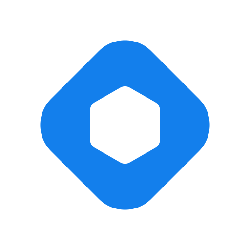
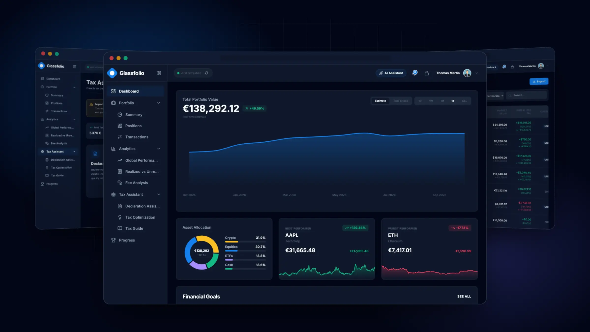
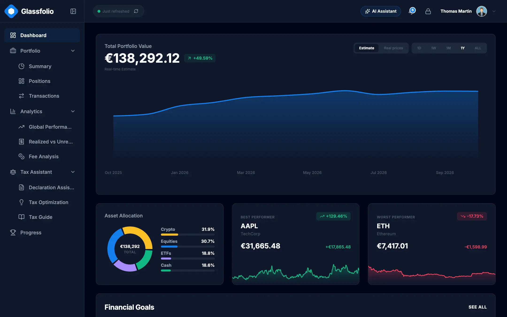
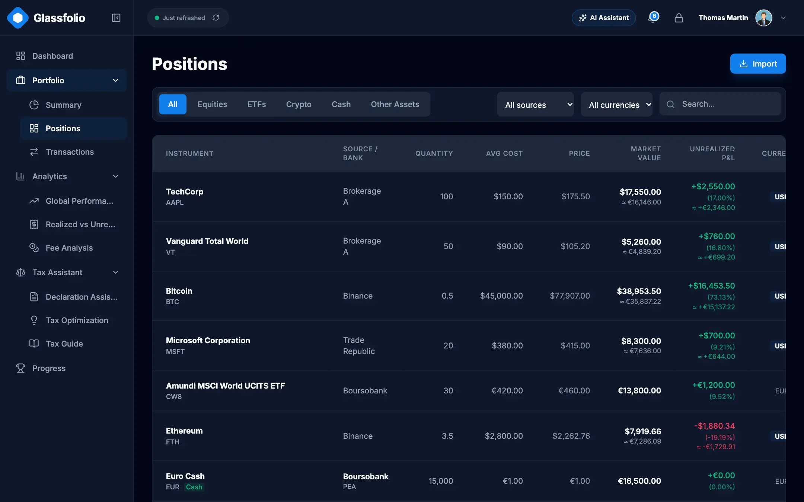
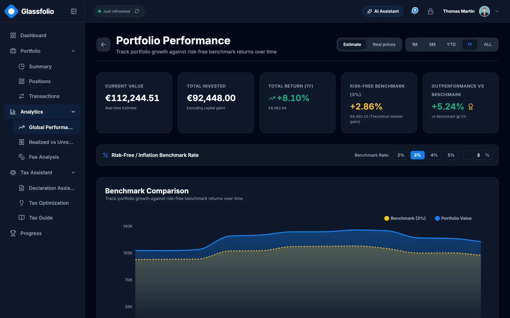
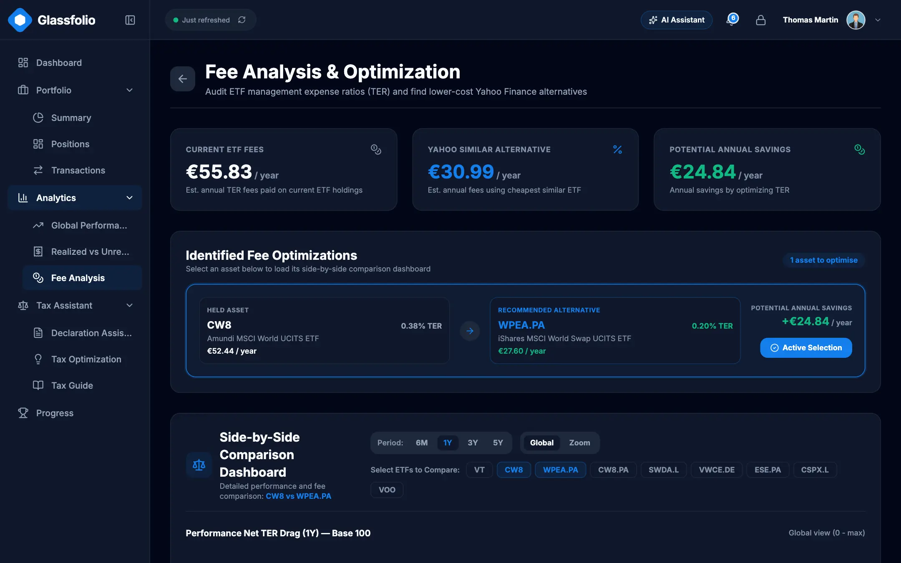
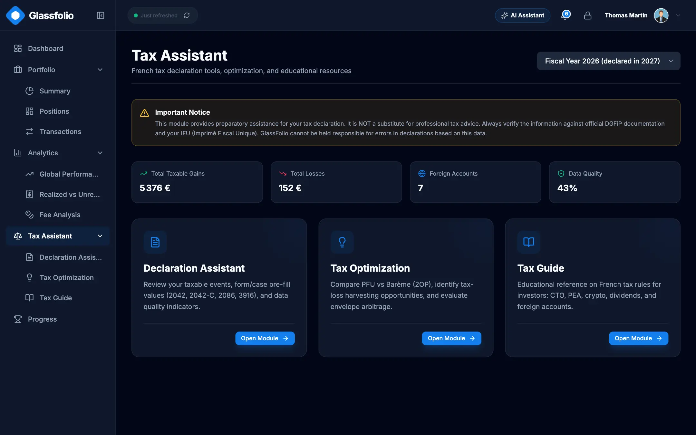
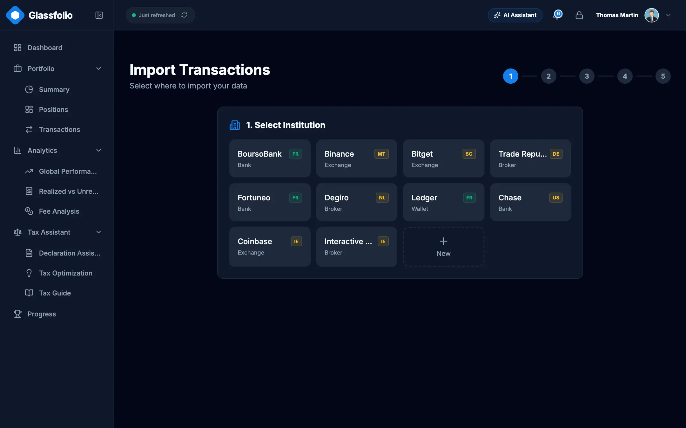
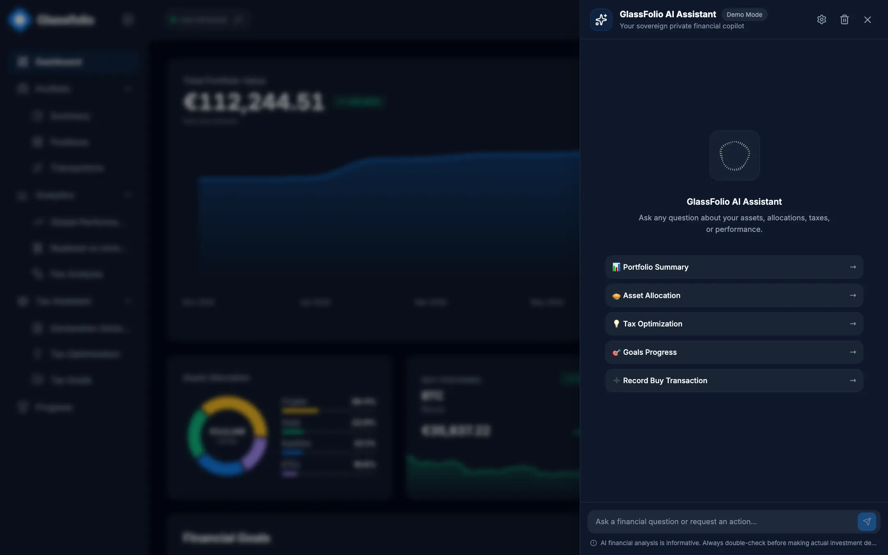
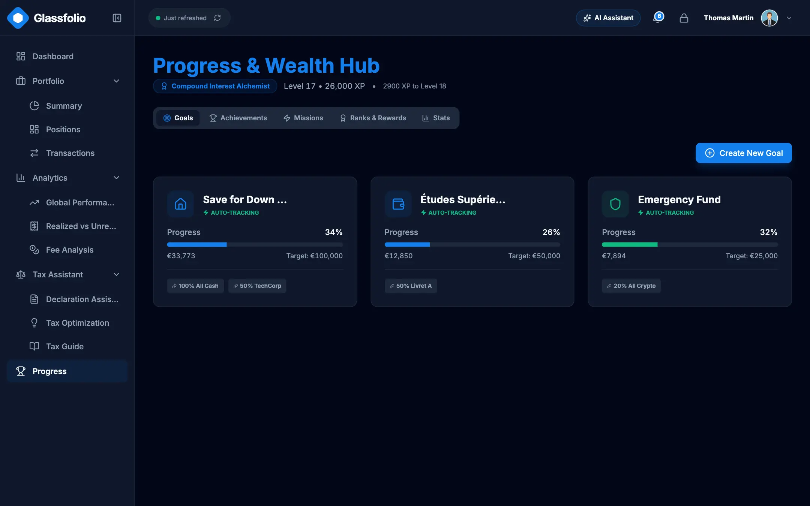

<div align="center">



# GlassFolio

**Your wealth, encrypted on your side. Self-hosted or in the cloud.**

A wealth dashboard that keeps your data encrypted, prepares your tax return with a modular tax engine (French rules built in), and runs on your own machine or in the managed cloud.

[](https://github.com/Damien-Esilv/GlassFolio/actions/workflows/ci.yml)
[](LICENSE)
[](package.json)
[](#-self-hosting-with-docker)
[](locales)

**English** · [Français](README.fr.md)

[**Website**](https://glassfolio.dev) · [**Self-host**](#-self-hosting-with-docker) · [**Roadmap**](https://glassfolio.dev/roadmap) · [**Changelog**](https://glassfolio.dev/changelog)

<br />



</div>

---

## Why GlassFolio

1. **Encrypted before it leaves your browser.** Transactions, holdings, goals and secrets live in a client-side vault: AES-256-GCM, with keys derived from your master password through PBKDF2 (600,000 iterations) and HKDF. A server only ever sees ciphertext.
2. **Self-hosted or cloud, your choice.** One command starts a hardened Docker container on your own machine or NAS, with no account and no telemetry. Or use the managed cloud version: nothing to install, synced across your devices. Same app, same encryption.
3. **A modular tax engine.** French rules are built in natively: compare the flat tax (PFU) with the progressive scale on your real numbers and prepare Cerfa 2042, 2074 and 3916. Rules are isolated by jurisdiction so new countries can be added.
4. **An AI assistant that asks first.** Ask questions about your portfolio in plain language, with a local model (Ollama) or your own API key. 32 tools are exposed to the in-app assistant and to external MCP clients, and every action that changes financial data needs your explicit approval.
5. **Bring your history.** Import CSV exports from your brokers and banks with column mapping, a live preview, duplicate protection and one-click rollback.

## ✨ Features

### Portfolio and markets
- Multi-asset tracking: equities, ETFs, crypto, cash and savings, grouped by asset class, institution and account (PEA, CTO, life insurance, wallets…).
- Positions with quantity, average cost, valuation and unrealized gains, plus realized vs unrealized P&L.
- Market prices from Yahoo Finance and CoinGecko, multi-currency conversion, graceful offline fallback.
- Full transaction ledger (buys, sells, dividends, fees, deposits, withdrawals) with filters and search.

### Analytics
- Performance over time, benchmark comparison and rebased (base 100) curves, with up to 8 series that never clash with gain/loss colors.
- ETF fee analysis: ongoing costs and their compounding effect over decades, plus side-by-side ETF comparison.
- Financial goals with progress tracking, and an investor progression system (ranks, quests, streaks).

### Tax engine
- Modular engine: rules are isolated by jurisdiction. French rules are built in today; new jurisdictions plug into the same pipeline.
- PFU vs progressive scale comparison, with PEA and holding-period rules.
- Declaration assistant for Cerfa **2042**, **2074** and **3916**, plus tax optimization hints.
- Cost basis computed on a shared ledger, with a selectable method.

> GlassFolio gives estimates and educational guidance. It is not certified tax or investment advice.

### Import and backup
- Presets that auto-detect Binance, Bitget, BoursoBank, Trade Republic, Coinbase, Kraken and GlassFolio exports, and a column-first mapping step for anything else.
- History mode and snapshot mode, a dedicated cash import, duplicate detection and per-batch rollback.
- Full JSON backup, and a merge wizard that previews changes before touching your data.

### AI and MCP
- In-app assistant with streaming, visible reasoning blocks and approval cards for sensitive actions.
- Local models through Ollama (no data leaves your machine), or OpenAI, Anthropic, OpenRouter and Groq with keys stored in your encrypted vault.
- Guardrails redact secrets (keys, recovery codes, TOTP seeds) before anything reaches a model.
- A standalone [MCP server](mcp-server/index.mjs) (`npm run mcp`, stdio) for Claude Desktop, Cursor and other MCP clients.

### Security and privacy
- Passwords checked against NIST SP 800-63B guidance, TOTP two-factor authentication with backup codes, WebAuthn passkeys, and an emergency recovery key.
- Encrypted secrets vault and an encrypted, append-only security audit log.
- Strict Content-Security-Policy (`script-src 'self'`, Trusted Types), no third-party script.

### Experience
- Three themes (light, dark, night), English and French, 16 translation namespaces.
- Semantic color tokens everywhere: one change to a token cascades to every screen and chart.

## 📸 Screenshots

<table>
  <tr>
    <td width="50%"><br /><sub><b>Dashboard</b>: net worth, allocation, performers</sub></td>
    <td width="50%"><br /><sub><b>Positions</b>: holdings by account and asset class</sub></td>
  </tr>
  <tr>
    <td width="50%"><br /><sub><b>Performance</b>: benchmark comparison over time</sub></td>
    <td width="50%"><br /><sub><b>Fees</b>: yearly and compounded cost of each fund</sub></td>
  </tr>
  <tr>
    <td width="50%"><br /><sub><b>Tax engine</b>: PFU vs progressive scale, Cerfa assistant</sub></td>
    <td width="50%"><br /><sub><b>Import</b>: broker presets, column mapping, live preview</sub></td>
  </tr>
  <tr>
    <td width="50%"><br /><sub><b>AI assistant</b>: questions answered from your data</sub></td>
    <td width="50%"><br /><sub><b>Progress</b>: savings goals, ranks and quests</sub></td>
  </tr>
</table>

## 🐳 Self-hosting with Docker

The image serves the app, proxies market data on the same origin and stores your vault records on a Docker volume. It needs [Docker](https://docs.docker.com/get-docker/) with Compose, and Node 22 on the host only for the `npm run docker:*` helpers.

### Quick start

```bash
git clone https://github.com/Damien-Esilv/GlassFolio.git && cd GlassFolio && npm run docker:up
```

Open <http://localhost:3000>, create your master password, and you are in.

```bash
npm run docker:logs    # follow the logs
npm run docker:down    # stop the container (your data is kept)
npm run docker:smoke   # build a throw-away container and verify it end to end
```

### Configuration

Set these variables in `docker/docker.env` (non-secret defaults) or in your shell. Secrets such as the access token belong in your shell, never in a file.

| Variable | Default | Purpose |
|---|---|---|
| `GLASSFOLIO_PORT` | `3000` | Host port the app is published on. |
| `GLASSFOLIO_BIND` | `127.0.0.1` | Host address to listen on. Anything other than loopback exposes GlassFolio to your network and requires a token. |
| `GLASSFOLIO_DATA` | named volume `glassfolio-data` | Host folder to store data in instead of the volume (must be writable by uid 1000). |
| `GLASSFOLIO_ALLOWED_HOSTS` | empty | Comma-separated domain names allowed to reach the vault API when you use a reverse proxy. `localhost` and IP addresses always work. |
| `GLASSFOLIO_ACCESS_TOKEN` | empty | Login password (HTTP Basic, user `glassfolio`). At least 16 characters, required when `GLASSFOLIO_BIND` is not loopback. |
| `GLASSFOLIO_CSP_CONNECT_SRC` | empty | Extra origins the page may call, space-separated (for example a remote Ollama). |

### Exposing it on your network

`npm run docker:up` refuses to start on a non-loopback address without a token:

```bash
GLASSFOLIO_BIND=0.0.0.0 GLASSFOLIO_ACCESS_TOKEN=$(openssl rand -hex 16) npm run docker:up
```

The browser then asks once for a login: user `glassfolio`, password = the token. The `/health` endpoint stays open for the container health check. HTTP Basic is not encrypted, so on an untrusted network put a TLS reverse proxy in front and list its domain in `GLASSFOLIO_ALLOWED_HOSTS`.

### Your data, backups and restore

In local mode the server volume is the source of truth: the vault records are stored there, end-to-end encrypted. The browser keeps only preferences (theme, language, consent), so clearing the cache or opening another browser loses nothing. Just unlock the vault with your master password. If two browsers edit at the same moment, the last write per record wins.

Docker Compose prefixes the volume with the project name, which is the folder name in lowercase (`glassfolio` if you cloned into `GlassFolio`). Check yours with `docker volume ls`.

```bash
# Back up
docker run --rm -v glassfolio_glassfolio-data:/data -v "$PWD":/backup alpine \
  tar czf /backup/glassfolio-data.tgz -C /data .
```

```bash
# Restore into the same volume (stop the container first)
npm run docker:down
docker run --rm -v glassfolio_glassfolio-data:/data -v "$PWD":/backup alpine \
  sh -c "cd /data && tar xzf /backup/glassfolio-data.tgz"
npm run docker:up
```

The archive only contains encrypted records, but it is still your financial data: store it accordingly. The app also offers a full JSON backup in the settings.

### Updating

```bash
git pull && npm run docker:up
```

The image is rebuilt and the container replaced; the data volume is untouched.

### Local AI with Ollama

In Settings, choose the Ollama provider and enter its address (`http://localhost:11434` by default). The call is made by your browser, so Ollama must allow the app origin (set `OLLAMA_ORIGINS`, for example `OLLAMA_ORIGINS=http://localhost:3000`). If Ollama runs on another machine, add its origin with `GLASSFOLIO_CSP_CONNECT_SRC=https://ollama.example.com`. The helper `npm run ollama:proxy` starts a small local CORS proxy on port 11435 if you need one.

### Container hardening

- Read-only root filesystem, `/tmp` on tmpfs, `cap_drop: ALL`, `no-new-privileges`.
- Runs as the non-root `node` user, with 512 MB memory and 128 process limits.
- Base image pinned by digest, health check built in.
- Binds to `127.0.0.1` by default; network exposure requires an access token.
- A strict CSP and security headers are sent by the server itself.

## ☁️ Local vs Cloud

GlassFolio is built once and ships in two modes.

| | **Local** (Docker / `npm run dev`) | **Cloud** ([app.glassfolio.dev](https://app.glassfolio.dev)) |
|---|---|---|
| Where data lives | Vault records on your server volume, the source of truth | Encrypted vault stored in Supabase |
| Accounts | Master password, with TOTP (and backup codes) and passkeys inside the vault | Supabase Auth, email verification, TOTP and passkeys |
| Access control | Optional HTTP Basic token on the container | Row Level Security per user |
| Who can read your data | Whoever has your password and your volume | Nobody else: the server only holds ciphertext |

The [showcase site](https://glassfolio.dev) presents the project and links to the hosted app.

## 💻 Development

Requirements: **Node 22.x** and npm.

```bash
git clone https://github.com/Damien-Esilv/GlassFolio.git
cd GlassFolio
npm install
npm run dev        # http://localhost:3000 (local mode)
```

To try it without entering data, sign in with the demo account `demo@glassfolio.com` / `password`, or open `/?demo=1`. Sample broker CSV files are in [`test-data/`](test-data).

| Script | Purpose |
|---|---|
| `npm run dev` / `dev:cloud` | Dev server in local mode / cloud (Supabase) mode |
| `npm run build` | Production build (`build:local`, `build:app`, `build:showcase` for specific targets) |
| `npm run preview` | Preview the production build |
| `npm run mcp` | Start the MCP server (stdio) |
| `npm run docker:up` / `docker:down` / `docker:logs` / `docker:smoke` | Self-hosting helpers |

## ✅ Quality and security

Six gates must pass locally before a merge, and CI runs them on every push:

```bash
npm run check:types && npm run lint && npm run check:i18n && npm run check:standards && npm run test:security && npm test
```

| Gate | What it protects |
|---|---|
| `check:types` | Strict TypeScript |
| `lint` | ESLint, including a rule against hardcoded UI text |
| `check:i18n` | Every key exists in both English and French |
| `check:standards` | Design tokens, architecture invariants, security headers, supply chain, no personal paths |
| `test:security` | Vault encryption, authentication, AI guardrails |
| `npm test` | Unit and integration tests (Vitest) |

Security design choices:
- **CSP**: `script-src 'self'`, no inline script, no `eval`. The headers come from a single source, `server/securityHeaders.mjs`, shared by Docker and Vercel and verified by tests and a post-deploy smoke check.
- **Trusted Types**: raw HTML is never injected; sinks go through named policies.
- **Supply chain**: Docker image pinned by digest, GitHub Actions pinned by commit SHA, npm packages checked against lockfile integrity hashes.

Found a vulnerability? Please follow the [security policy](.github/SECURITY.md) and do not open a public issue.

## 🧱 Tech stack and architecture

React 19, TypeScript, Vite, React Router, Tailwind CSS (colors from CSS variables per theme), Recharts, i18next, Zod, Web Crypto API, Supabase (cloud mode), a dependency-free Node server for Docker, Vitest.

```
src/
├── pages/        Routed screens (dashboard, positions, tax, import…)
├── components/   Reusable UI and security dialogs
├── context/      Auth, data, themes and preferences
├── services/     Data layer: repositories, encrypted storage, import, tax, AI tools, security
└── types/        Shared TypeScript types
server/           Zero-dependency Node runtime for Docker (static files, vault API, market proxy)
mcp-server/       Standalone MCP server
locales/          English and French translations
supabase/         Cloud-mode migrations and edge functions
```

Components never touch storage directly: they go through `src/services/`, which writes encrypted records either to the server volume (local mode) or to Supabase (cloud mode).

## 🤝 Contributing

Contributions are welcome. Read [CONTRIBUTING.md](CONTRIBUTING.md) first: it explains how contributions are accepted and what must pass before a pull request. Project conventions are in [AGENTS.md](AGENTS.md) and [AI_CODING_STANDARDS.md](AI_CODING_STANDARDS.md).

## 📄 License

GlassFolio is **source-available** under the [PolyForm Noncommercial License 1.0.0](LICENSE). It is not open source in the OSI sense.

- You can download, run, study and modify it for any **non-commercial** purpose, including personal use and self-hosting.
- You cannot use it commercially or sell it, modified or not.
- The author keeps the intellectual property.
